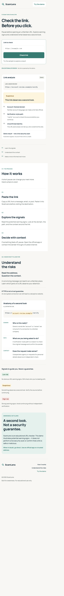

# ScamLens UI/UX Assignment

ScamLens is an educational URL-checking prototype. It demonstrates potential warning signs and clearly states that results are not live security scans.

## Deliverables

- V1 implementation: `v1/index.html`, `v1/styles.css`, `v1/script.js`
- V2 implementation: `v2/index.html`, `v2/styles.css`, `v2/script.js`
- Comparison: `docs/comparison.md`
- Assignment report: `docs/report.md`
- Prompt journal: `docs/prompts.md`
- Screenshot evidence: `screenshots/`

## Figma

- [V1 desktop frame](https://www.figma.com/design/BWkZzTogYEGR20n807xVt2/Untitled?node-id=3-45)
- [V2 desktop frame](https://www.figma.com/design/BWkZzTogYEGR20n807xVt2/Untitled?node-id=4-22)
- [V2 mobile frame](https://www.figma.com/design/BWkZzTogYEGR20n807xVt2/Untitled?node-id=4-176)
- [URL form component states](https://www.figma.com/design/BWkZzTogYEGR20n807xVt2/Untitled?node-id=4-362)

## Run locally

V1:

```bash
python3 -m http.server 4173 -d v1
```

Open `http://127.0.0.1:4173/`.

V2:

```bash
python3 -m http.server 4174 -d v2
```

Open `http://127.0.0.1:4174/`.

## Screenshot evidence

### Before: V1



### After: V2


Verified in the browser tool:

- V2 loads `assets/scamlens-mark.svg` locally.
- At the <=620 px breakpoint, the 40 px hero heading computes to 40 px with 48 px line-height.
- The header logo and “Try the demo” button remain in one row; the button has `white-space: nowrap` and `flex-shrink: 0`.
- The overflow probe found no element beyond the reported viewport.

The browser tool still reported a 487 px inner width despite setting a 390 px page viewport, so these are matching-browser-session captures, not exact 390 px CSS screenshots. Figma desktop exports were scaled and are not labelled as exact 1440 px viewport screenshots.

## Known limitation

The Figma Starter MCP tool-call limit blocked final canvas repair and re-export of mobile frame `4:176`. The limitation is documented in `docs/report.md` and `docs/comparison.md`. No GitHub publication was performed.
