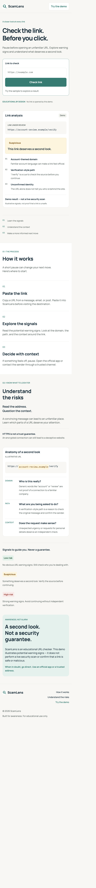

# ScamLens Assignment Report

## 1. Objective

Create a responsive educational URL-checking interface, preserve V1, improve it in a V2 Figma iteration, generate V2 code, compare evidence, and prepare submission artifacts without publishing online.

## 2. Figma sources

- [V1 desktop](https://www.figma.com/design/BWkZzTogYEGR20n807xVt2/Untitled?node-id=3-45)
- [V2 desktop](https://www.figma.com/design/BWkZzTogYEGR20n807xVt2/Untitled?node-id=4-22)
- [V2 mobile](https://www.figma.com/design/BWkZzTogYEGR20n807xVt2/Untitled?node-id=4-176)
- [Form state variants](https://www.figma.com/design/BWkZzTogYEGR20n807xVt2/Untitled?node-id=4-362)

## 3. Before and after

### Before: V1

V1 contains the desktop-first implementation and lacks the final dedicated mobile iteration.

### After: V2

V2 includes the 20 px mobile gutter, 40 px hero heading, stacked layouts, 44 px controls, and named form states.

Verified V2 code fixes:

- `v2/assets/scamlens-mark.svg` exists and loads independently from V1.
- Both logo references use `assets/scamlens-mark.svg`.
- The header brand and “Try the demo” button stay on one row. The button is non-wrapping and has `flex-shrink: 0`.
- The mobile `<h1>` computes to 40 px font-size with 48 px line-height.
- Browser geometry reported no element outside the reported viewport.

The browser probe again reported 487 px inner width despite requesting 390 px, so this capture is not an exact 390 px viewport screenshot.

## 4. Differences table

| Area | V1 | V2 |
|---|---|---|
| Desktop structure | Two-column hero and educational sections | Duplicated V2 desktop frame with V1 structure preserved |
| Mobile frame | Not dedicated | 390 px-wide V2 mobile frame exists |
| Side padding | Desktop-first values | 20 px at <=620 px |
| Hero heading | 64 px desktop value | 40 px at <=620 px, 48 px line-height |
| Layout | Desktop columns | Stacked hero, steps and risk grids on mobile |
| Touch targets | Mixed | 44 px minimum for primary controls/navigation |
| Form states | Static form | Empty, focused, invalid, loading and demo-result variants |
| Demo transparency | Existing demo disclaimer | Demo result remains explicitly non-live |

## 5. Figma verification

Verified:

- V1 node `3:45` remains present.
- V2 desktop node `4:22` exists.
- V2 mobile node `4:176` is 390 px wide.
- Form state set `4:362` contains the five required variants.
- V1 files remain unchanged.

Found in metadata:

- V2 mobile metadata height was 16,612 px.
- Several child frames had widths of 18 px and inherited heights instead of 350 px stacked mobile widths.
- Header navigation and demo action extended outside the 350 px content area.
- The 10 x 390 exported PNG was unusable.

## 6. Verified implementation

- V2 code is in `v2/` with CSS variables for existing colors and named spacing tokens.
- Invalid URL submission shows validation feedback.
- Loading briefly changes form feedback.
- Demo submission replaces the result with an explicitly labeled demo state.
- Browser evaluation found no elements outside the reported viewport.

## 7. Limitations

- The Figma MCP Starter-plan tool-call limit blocked the remaining canvas mutation and re-read after the geometry repair attempts.
- No exact 390 px Figma export was produced because the existing export returned 10 x 390 pixels and the MCP write limit prevented correction/re-export.
- Shared browser tools reported 487 px inner width when 390 px was requested, so the refreshed captures are matching-browser-session evidence but not exact 390 px screenshots.
- Refreshed screenshot dimensions: V1 `976 x 9028`, V2 `610 x 12264`; these differ because of browser capture scaling and device-capture behavior.
- The Figma mobile frame remains a draft: the source metadata showed invalid mobile child bounds and the MCP repair/re-export was blocked by quota.
- Figma desktop exports at 785 x 1440 are scaled captures, not exact 1440 px viewport captures.
- No pixel-diff score is claimed.

## 8. Conclusions

V1 remains the original implementation and is preserved. V2 successfully isolates the new code, responsive rules, form states, and demo behavior. The Figma mobile frame's source dimensions must still be repaired/re-exported once MCP quota is available. The current evidence is honest about this blocker and does not present the unusable 10 x 390 export or scaled browser captures as exact verification.

## 9. Russian defense guide

Коротко защитить проект так:

1. **Цель:** ScamLens помогает пользователю остановиться и проверить подозрительную ссылку, не утверждая реальную безопасность.
2. **V1:** исходный макет сохранён без изменений в папке `v1/`.
3. **V2:** создан отдельный вариант в `v2/`, с адаптивной сеткой, CSS-переменными и вариантами формы.
4. **Figma:** V1 — узел `3:45`, desktop V2 — `4:22`, mobile V2 — `4:176`, component set — `4:362`.
5. **Важно честно:** мобильный frame существует шириной 390 px, но metadata показала некорректные дочерние bounds. Экспорт был 10 x 390 и unusable.
6. **Ограничение:** MCP достиг лимита Starter-плана, поэтому финальную правку и повторный экспорт canvas не удалось завершить.
7. **Browser:** проверены invalid/loading/demo состояния и отсутствие видимого overflow в tool, но браузер сообщил ширину 487 px вместо 390 px.
8. **Результат:** код V2 готов; GitHub publishing намеренно не выполнялся.
